<p align="center">
  
</p>

<p align="center">
  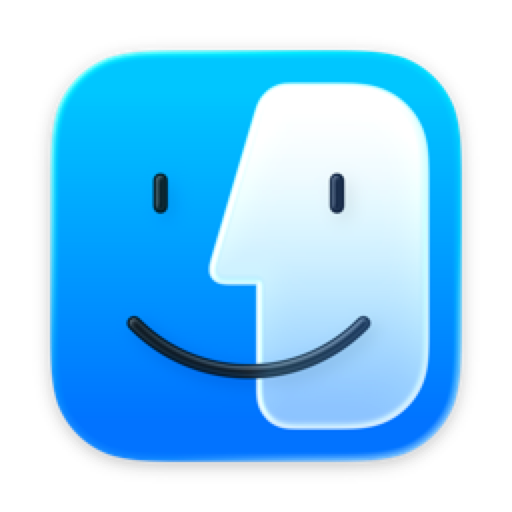
</p>

<h1 align="center">
  <em>NehangOS</em>
</h1>

<p align="center">
  <strong>this is a Mac now.</strong><br/>
  <sub>please do not ask where the files went.</sub>
</p>

<p align="center">
  <strong>Before:</strong> portfolio.&nbsp;&nbsp;<strong>After:</strong> operating system.&nbsp;&nbsp;<strong>Therapy:</strong> pending.
</p>

<p align="center">
  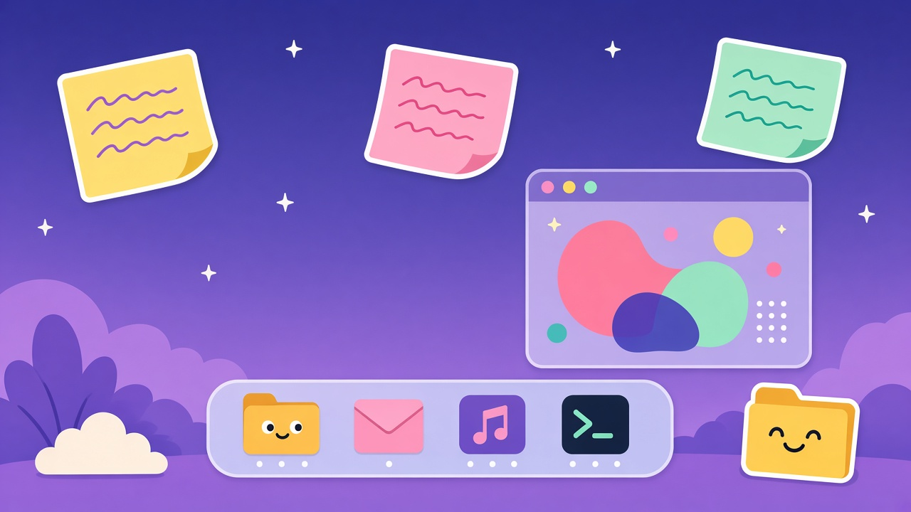
</p>

```text
NehangOS Boot Log · build 26.8
[  OK  ] sticky notes loaded (slightly crooked)
[  OK  ] dock magnification armed
[  OK  ] Eastern Thought queued
[ WARN ] matching socks not found
[  OK  ] Mail app online — recruiters welcome
[  OK  ] desktop ready. try not to rearrange everything.
```

<p align="center">
  <code>boot → unlock → desktop → chaos (affectionate)</code>
</p>

<p align="center">
  <a href="https://nehang-portfolio.vercel.app"><strong>🌐 nehang-portfolio.vercel.app</strong></a><br/>
  <sub>sit down at the live desktop →</sub>
</p>

<p align="center">
  <a href="https://nehang-portfolio.vercel.app">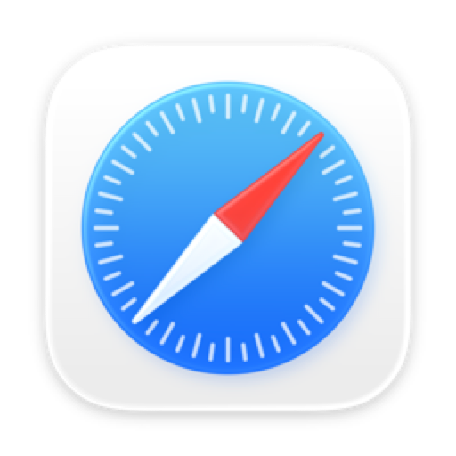</a>
  &nbsp;
  <a href="mailto:nehangal@usc.edu"></a>
  &nbsp;
  <a href="https://github.com/NehangPatel23">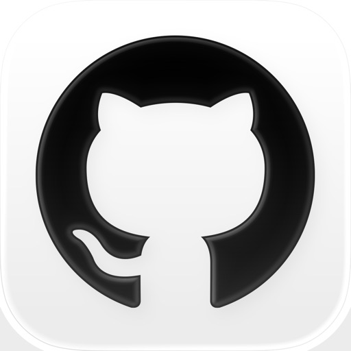</a>
  &nbsp;
  <a href="https://www.linkedin.com/in/nehangpatel/"></a>
  &nbsp;
  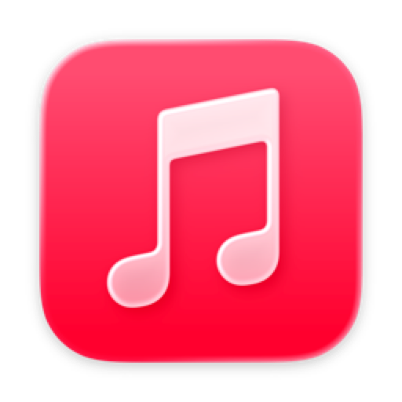
  &nbsp;
  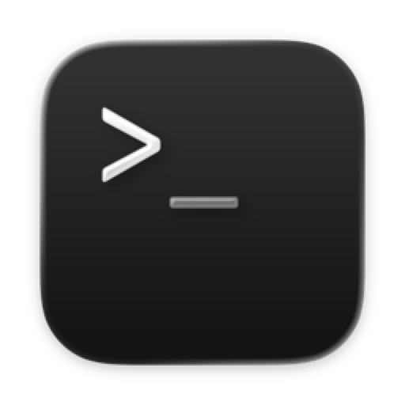
</p>

---

## hey, I'm Nehang 👋

I got tired of the usual portfolio — hero section, three cards, footer saying "let's connect." So I built a computer instead.

**NehangOS** is my portfolio dressed up as a macOS desktop. You boot it. You unlock it. You drag windows around like you meant to be productive. There's a dock. There's a notch with music. There's sticky notes that tell on me. There's a terminal that will answer `whoami` without judging you (much). Prefer clicking to cloning? → **[nehang-portfolio.vercel.app](https://nehang-portfolio.vercel.app)**

I'm an **MS CS** student at **USC Viterbi**, previously **BS CS** at the University of Cincinnati (cyber ops minor, because why not). Based in Los Angeles. Currently open to **internships** and **new-grad SWE** roles — if that's you, skip the scroll. Open Mail. It works.

> 📮 *recruiters:* the Mail app actually works. try it.  
> — sticky note on my desktop, yellow, slightly crooked

---

## system dialog 💬

<p align="center">
  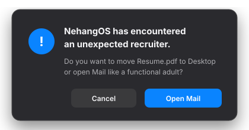
</p>

<p align="center">
  <sub>spoiler: the correct button is Open Mail.</sub>
</p>

---

## the dock (aka the vibes tray)

<p align="center">
  
  
  
  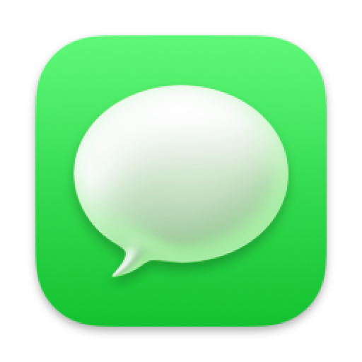
  
  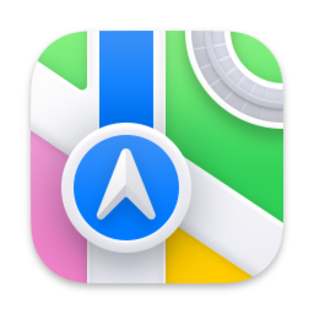
  
  
  
  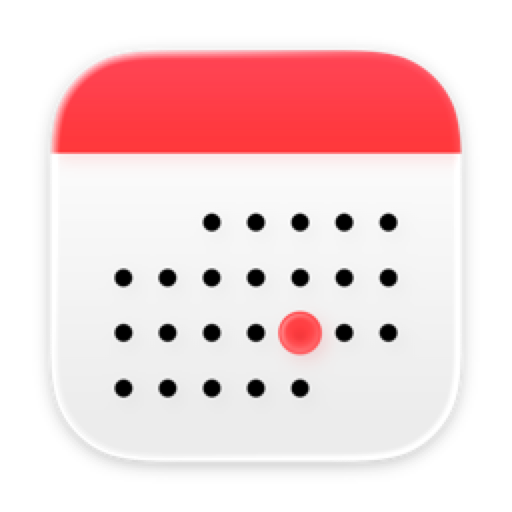
  
  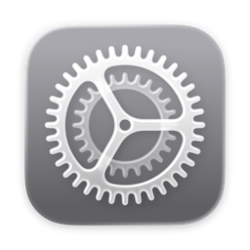
  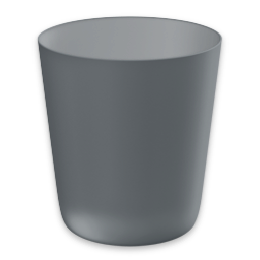
</p>

<p align="center"><sub>yes I put Trash in the README. respect the ecosystem.</sub></p>

---

## what you can actually *do* in here 🎮

| vibe | thing |
|:----:|:------|
| 📂 | Double-click desktop folders → **Projects**, **Experience**, **Education**, **Resume.pdf** |
| 🔍 | Hit <kbd>⌘K</kbd> for Spotlight when you refuse to use a mouse like a normal person |
| 💻 | Open **Terminal** → type `help`, `whoami`, `neofetch`, `open projects`… |
| 🎵 | Click the **notch** — music, calendar crumbs, shortcuts, a little mirror cam if you're brave |
| ⚙️ | **System Settings** — wallpaper, dock size, dark mode, the whole "I live here now" package |
| 🗑️ | Drag stuff to Trash. Empty it. Feel power. (It's theater. Beautiful theater.) |

Also: Control Center, Launchpad, Quick Look-ish previews, Stage Manager energy, Focus mode… I got a little carried away. No regrets.

---

## keyboard shortcuts (sort of) ⌨️

| keys | alleged purpose | actual outcome |
|:----:|:----------------|:---------------|
| <kbd>⌘K</kbd> | Spotlight | find anything except your keys |
| <kbd>⌘W</kbd> | Close window | close the one you meant to keep |
| <kbd>Space</kbd> | Quick Look | stare at Resume.pdf like it owes you money |
| click notch | Media controls | accidentally start a whole Bollywood era |
| drag → Trash | Delete | emotional closure (files are fine) |
| any key @ lock | Unlock | you are hired. spiritually. |

---

## sticky notes from the desktop 📝

<p align="center">
  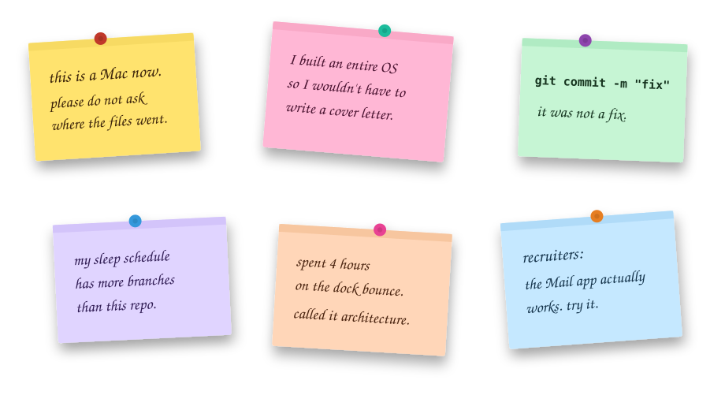
</p>

<p align="center">
  <sub>yes they're slightly crooked on purpose. that's the brand.</sub>
</p>

---

## projects living in the folder 🗂️

<p align="center">
  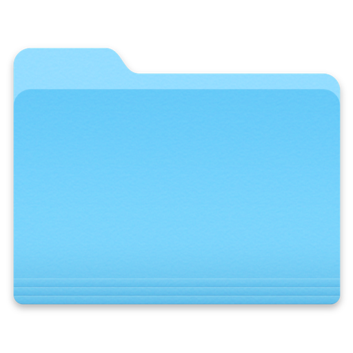
  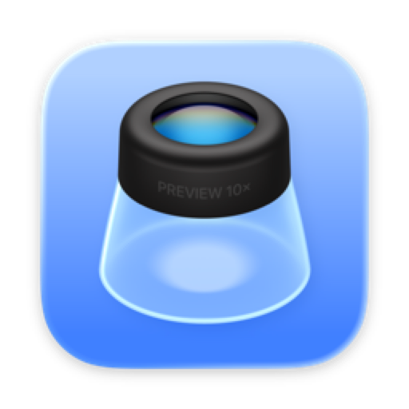
  
  
</p>

Stuff I've shipped / am shipping — the real case studies live *inside* the OS under **Projects** (open the folder, don't make me paste dashboards here):

- **NexusIQ AI** — full-stack AI product energy  
- **MoodBoard AI** — vibe boards, but make it ship  
- **Dirscope** — native macOS Quick Look for folders & zips (yes, real Swift)  
- **FinTrackr** — Flutter finance app with the whole dashboard family  
- **CourseArc**, **PulseBoard**, **RevStream AI**, scraping pipelines, MediTechSafe UI…  

Open the folder on the desktop. Click around. Pretend you're reviewing my PR.

---

## known issues 🐛

- Dock magnification may cause **unearned confidence**
- Light mode exists but **we don't talk about it**
- Files in Trash are **emotionally gone** (still recoverable, don't panic)
- `git commit -m "fix"` occasionally describes a feature
- Battery widget is decorative; please bring your own charger
- Matching socks: **not found** (see boot log)
- Cover letters: deprecated in favor of this entire operating system

---

## system requirements 📋

| thing | requirement |
|:------|:------------|
| Browser | any (judgment reserved for IE fans) |
| Attention span | optional |
| Sense of humor | **required** |
| Node / npm / webpack | absolutely not |
| Cover letter | deprecated — see entire OS above |

---

## run it on your machine 🖥️

<p align="center">
  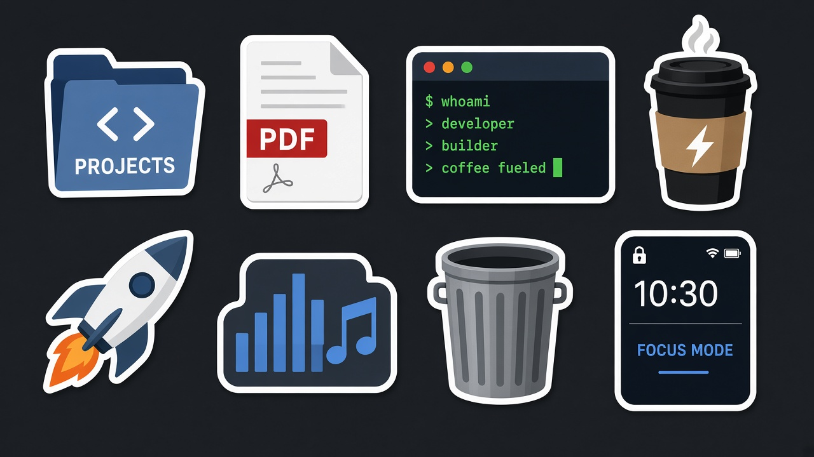
</p>

No `npm install`. No webpack lore. No "please upgrade Node."

It's HTML + CSS + vanilla JS. Open `index.html`… or serve it like a civilized person:

```bash
# the classic
python3 -m http.server 8080

# then visit
open http://localhost:8080
```

Deploy is just "point Vercel at this repo and walk away."

```
nehang-portfolio-os/
├── index.html          ← the whole stage
├── assets/
│   ├── css/            ← OS chrome + mac polish
│   ├── js/os.js        ← window manager, apps, terminal, chaos
│   ├── icons/macos/    ← the little friends in the dock
│   ├── readme/         ← doodles for this page (yes, meta)
│   ├── music/          ← soundtrack for deep work / fake deep work
│   ├── projects/       ← case study screenshots (in the OS, not here)
│   └── resume/         ← the PDF recruiters pretend they opened
└── vercel.json         ← tiny deploy manners
```

---

## terminal flex zone 🖤

```text
$ whoami
nehang — ms cs @ usc · builds things that feel considered

$ neofetch
NehangOS 26.8
host: a browser tab with commitment issues
shell: zsh (spiritual)
uptime: since I got bored of boring portfolios

$ open mail
→ please be nice. or at least interesting.
```

Try these for real inside the site: `help` · `ls` · `cat` · `open` · `resume` · `contact` · `clear`

---

## soundtrack 🎧

There's a whole Music app. Bollywood mix. English mix. Kevin MacLeod doing the Lord's work.

All tracks by **[Kevin MacLeod](https://incompetech.com)** — [CC BY 3.0](http://creativecommons.org/licenses/by/3.0/).  
Full list: [`assets/music/CREDITS.txt`](assets/music/CREDITS.txt)

*Eastern Thought* is the default. You're welcome / I'm sorry.

---

## right now 📍

🎓 MS CS @ USC Viterbi  
🏛️ President of **GRIDS @ USC** (since May 2026)  
🧠 previously taught design thinking to **1,500+** students  
🌆 Los Angeles  
🟢 open to internships & new-grad software engineering roles

I build full-stack products, data pipelines, and AI-backed tools — the kind of work that feels as considered as it functions. Clean architecture. Honest UX. Something you can actually ship.

---

## contributing (for recruiters) 🤝

```bash
# optional
git clone https://github.com/NehangPatel23/nehangOS-portfolio.git

# preferred pull request
open mailto:nehangal@usc.edu
```

**Accepted contributions:** internship offers, new-grad SWE convos, interesting problems, coffee near USC.  
**Rejected contributions:** "quick chats" with no role, unpaid "exposure," asking me to redesign your cousin's Shopify.

Subject line tips: mention the role. Bonus points if you survived the desktop without asking where the files went.

---

## say hi before the battery hits 1% 🔋

<p align="center">
  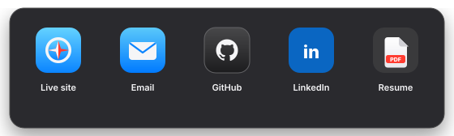
</p>

<p align="center">
  <a href="https://nehang-portfolio.vercel.app"><b>Live site</b></a>
  &nbsp;·&nbsp;
  <a href="mailto:nehangal@usc.edu"><b>nehangal@usc.edu</b></a>
  &nbsp;·&nbsp;
  <a href="https://github.com/NehangPatel23"><b>GitHub</b></a>
  &nbsp;·&nbsp;
  <a href="https://www.linkedin.com/in/nehangpatel/"><b>LinkedIn</b></a>
  &nbsp;·&nbsp;
  <a href="assets/resume/Resume_Nehang_Patel_Software_Engineer_2026-08.pdf"><b>Resume.pdf</b></a>
</p>

<p align="center">
  <sub>two pages, no lore dump</sub>
</p>

---

## license 📜

**[MIT](LICENSE)** for the code. Personality not for sale.

---

<p align="center">
  <sub>
    <em>NehangOS 26.8 · Software Update: up to date</em><br/>
    <code>git commit -m "fix"</code><br/>
    it was not a fix.
  </sub>
</p>

<p align="center">
  
</p>
